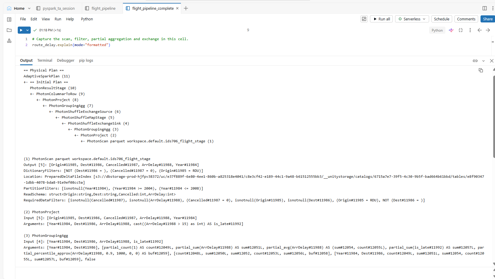
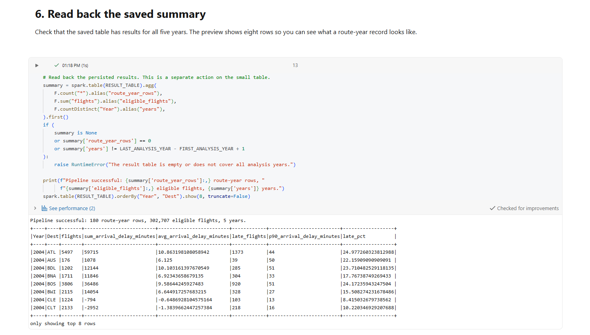
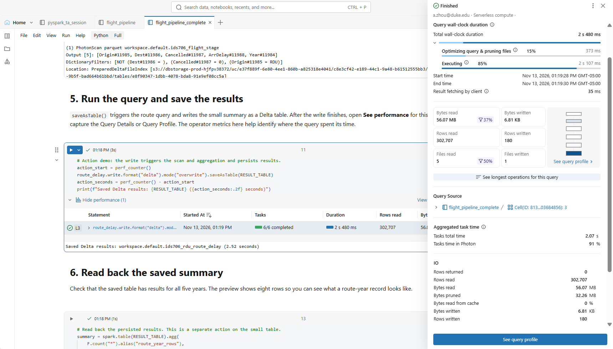
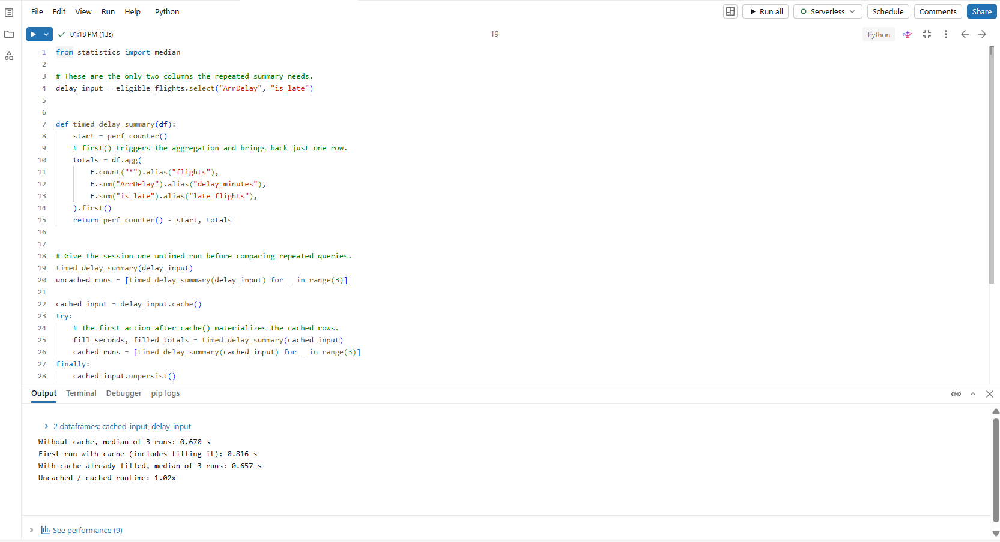

# RDU Flight Delays with PySpark

This IDS 706 project uses PySpark on Databricks Serverless to analyze arrival delays on flights departing Raleigh–Durham (RDU). It asks two questions about 2004–2008: Which destinations had the highest average arrival delay, and how did the share of late arrivals change from year to year?

## Dataset

The input is ten annual CSV files from 1999 through 2008, totaling **6,286,007,363 bytes (6.286 GB)**. The files come from the [ASA Data Expo 2009 airline on-time performance dataset](https://doi.org/10.7910/DVN/HG7NV7) and are available in Databricks at `/databricks-datasets/asa/airlines/`. The notebook verifies the ten filenames and their combined size before processing.

The analysis keeps noncancelled RDU departures from 2004 through 2008 with a destination and a recorded arrival delay. A flight counts as late if it arrived **more than 15 minutes** after schedule. Negative delays represent early arrivals and are included in the average.

## Pipeline and assignment requirements

| Requirement | Implementation | Notebook sections |
| --- | --- | --- |
| Load at least 1 GB with PySpark | Verify the input size and read all ten annual CSVs with Spark. | 1–2 |
| Two or more filters | Filter by year, origin, cancellation status, nonblank destination, and non-null arrival delay before aggregating. | 3 |
| Column transformations with `withColumn()` | Cast year, cancellation status, and arrival delay to integers, create `is_late`, and calculate the late-arrival percentage. | 2–3 |
| Complex aggregation with `groupBy()` | Group by year and destination. Compute flight count, delay totals and averages, late-flight count, and the approximate 90th percentile of arrival delay. | 3 |
| Two SQL queries | Rank the five destinations with the highest average delay among routes with at least 1,000 eligible flights, then compare delay metrics across the five years. Both queries use totals to give each flight equal weight. | 7–8 |
| Query optimization and physical plan | Stage the data in Delta partitioned by year, project the required columns, filter early, and inspect the formatted physical plan. | 2–5 |
| Persist and verify results | Save the route-year summary to `workspace.default.ids706_rdu_route_delay` and read it back to check year coverage and flight counts. | 5–6 |

## Actions vs. transformations

Section 3 builds the route query with `filter()`, `select()`, `withColumn()`, and `groupBy().agg()`. Building that plan took **0.0024 s** in the notebook. Section 4 uses `explain(mode="formatted")` to inspect the plan. Section 5 calls `saveAsTable()`, the action that executes the route query and persists the results. The notebook measured **2.52 s** for that write call.

## Performance analysis

The CSV ingestion keeps five fields and writes the staging table partitioned by `Year`. In the route query, the `PhotonScan` node lists the 2004–2008 bounds under `PartitionFilters`, allowing Spark to skip the earlier year partitions. Its `ReadSchema` lists four Parquet columns: `Origin`, `Dest`, `Cancelled`, and `ArrDelay`. `Year` comes from the partition. The scan also lists `Origin = 'RDU'`, `Cancelled = 0`, and the destination and delay validity checks under `RequiredDataFilters`. The Query Details panel reports **5 files and 56.07 MB read**, with **32.26 MB pruned**.

Spark uses `PhotonGroupingAgg` to compute partial aggregates before `PhotonShuffleExchangeSink` redistributes them by year and destination. This reduces the amount of data exchanged because each worker can combine its local rows first. The pipeline avoids an explicit `repartition()` or a global sort before grouping. The write produces **180 route-year records** in one output file, and the ranking sorts only the small destination summary.

Query Details reports **2.480 s** of wall-clock time for the summary write, with **373 ms (15%)** for optimization and file pruning and **2.107 s (85%)** for execution. Execution was the larger phase in this run. The captured breakdown is at the phase level, so the dominant individual operator is undetermined. The separate CSV-to-Delta staging write took **25.94 s** and was the largest measured step in the pipeline. That step processes all ten input files, while the summary query reads the filtered Delta data.

## Key findings

The pipeline analyzed **302,707 eligible flights** across five years and produced **180 route-year records**. Newark (EWR) had the highest average arrival delay among destinations with at least 1,000 eligible flights.

| Destination | Flights | Average arrival delay (min) | Late arrivals |
| --- | ---: | ---: | ---: |
| EWR | 18,235 | 21.14 | 34.32% |
| LGA | 22,429 | 15.34 | 32.70% |
| AUS | 2,195 | 14.83 | 32.76% |
| ORD | 13,588 | 13.67 | 25.77% |
| JFK | 16,343 | 13.31 | 27.15% |

The annual late-arrival rate rose from **19.93% in 2004** to a peak of **23.33% in 2006**, a difference of **3.40 percentage points**. It then fell to **22.79% in 2007** and **21.42% in 2008**. Average arrival delay also peaked in 2006 at **9.96 minutes**.

## Caching experiment (bonus)

Section 9 runs the same aggregation over the filtered delay columns three times per condition after an initial warm-up. The first action after `.cache()` fills the cache and is timed separately. The notebook checks that all runs return the same totals and releases the cached data with `.unpersist()`.

| Measurement | Time |
| --- | ---: |
| Without caching, median of three runs | 0.670 s |
| First cached action, including cache fill | 0.816 s |
| With the cache filled, median of three runs | 0.657 s |

The median decreased by **13 ms**, or about **1.02×** in the ratio of uncached to cached runtime. The improvement was small in this run, and the first action that filled the cache took longer than the uncached median.

## Delay classification with MLlib (optional)

Section 10 uses a Spark MLlib logistic regression model to predict whether a flight arrives more than 15 minutes late. The only feature is its destination, which is known before departure. Actual arrival delay is used to create the label. The model fits the destination indexer, one-hot encoder, and classifier on **2004–2007** flights, then evaluates on **58,790** flights from **2008**. The time split keeps the test year out of training and preprocessing.

| Test metric | Result |
| --- | ---: |
| Share of flights arriving more than 15 minutes late | 21.4% |
| Accuracy of predicting no late arrivals for every flight | 78.6% |
| Logistic regression accuracy | 78.6% |
| Logistic regression ROC AUC | 0.579 |

The model matched the baseline accuracy. The ROC AUC indicates that destination alone provided a modest signal for ranking flights by delay risk.

## Databricks screenshots

### Physical execution plan

### Successful pipeline execution

### Query Details

### Caching benchmark

## Run the notebook

Import [flight_pipeline_complete.ipynb](flight_pipeline_complete.ipynb) into Databricks, connect to Serverless, and run the sections in order. The notebook uses the workspace's sample data and overwrites its two named Delta tables on each full run. If needed, set `STAGING_TABLE` and `RESULT_TABLE` to a writable catalog and schema before running. The [HTML export](flight_pipeline_complete.html) includes the recorded outputs.
